  

 

  

  

    
    
    
    
  

  

    <b>I build end-to-end products — from data model to UI — with a backend-first mindset.</b> 
    ADSO @ SENA · 6th semester · Open to internships and junior full-stack roles
  

## ⚛ `~/about-me.ts`

  

## ⚛ `$ cat strengths.yaml`

  

How I work: end-to-end ownership · clear documentation · code reviews · iterative delivery

## ⚛ `$ cat tech-stack.yaml`

  

## ⚛ `$ ls ~/featured-projects`

  

    &nbsp;
  

  

    &nbsp;
  

  

    
  

## ⚛ `$ git log --graph --oneline --all`

  

## ⚛ `$ gh stats --all`

  
A snapshot of the work behind the projects.

  
  

    

  

    

  

## ⚛ `$ tail -f contributions.log`

  

## ⚛ `$ contact --david`

  

  

    
    
    
  

  
<b>Open to internships and junior full-stack roles.</b> Let's build something that ships.

  

